# AVA Boulder Dash

[](https://github.com/Harlock123/AVABoulderDash/actions/workflows/build.yml)

A dig-and-dodge puzzle game in the style of Peter Liepa and Chris Gray's 1984 Commodore 64 classic **Boulder
Dash**, built with .NET 10 and Avalonia UI. Dig through the dirt as Digby, the miner in the yellow helmet.
Collect enough diamonds and the way out opens. Keep clear of the boulders you loosen as you go, and of the
fireflies, butterflies and slime that share the caves.

## Features

- **Eight caves, A to H:** First Dig, Rockfall, Firefly Hollows, Butterfly Garden, The Slime, The Magic Wall,
  The Maze and The Vault. Start from A, C, E or G. After H the caves come round again, with less time each
  round.
- **The cave moves in turns**, the way the old game did: every square is looked at once, top to bottom, left
  to right. On screen, everything glides smoothly between squares.
- **Boulders and diamonds** fall into empty space, and roll off anything round (boulders, diamonds, brick
  walls) when there's room beside and below. One landing on Digby, a firefly or a butterfly blows it up,
  along with the eight squares round it. Steel survives.
- **Digby** digs through dirt and collects diamonds. He can push a boulder sideways into empty space after a
  moment's shove. Hold the button with a direction to grab a diamond or dig a square without moving.
- **Diamonds:** each cave needs a number of them, and once enough are in, the rest are worth more. The way
  out opens when the needed count is reached. Time left on the clock becomes points, and every 500 points
  earns an extra life.
- **Fireflies** keep a wall on their left and blow up when they touch Digby or the slime. **Butterflies**
  keep a wall on their right, and blow up into diamonds: drop a boulder on one.
- **The slime** spreads, slowly at first and then faster. Shut it in and it turns to diamonds; let it grow
  too big and it turns to stone.
- **The magic wall**, while it hums, turns falling boulders into diamonds (and diamonds into boulders).
- **Shut in?** Press R to give up the try, at the cost of a life.
- **The attract mode** shows the computer player digging the first cave. Before each step, it tries the
  next few turns out on a copy of the cave.

## Screenshots

| The title | First Dig | Rockfall |
|:---------:|:---------:|:--------:|
| 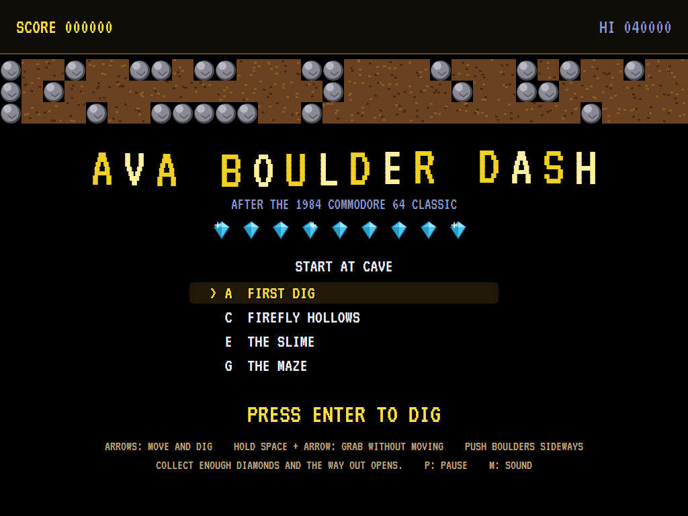 | 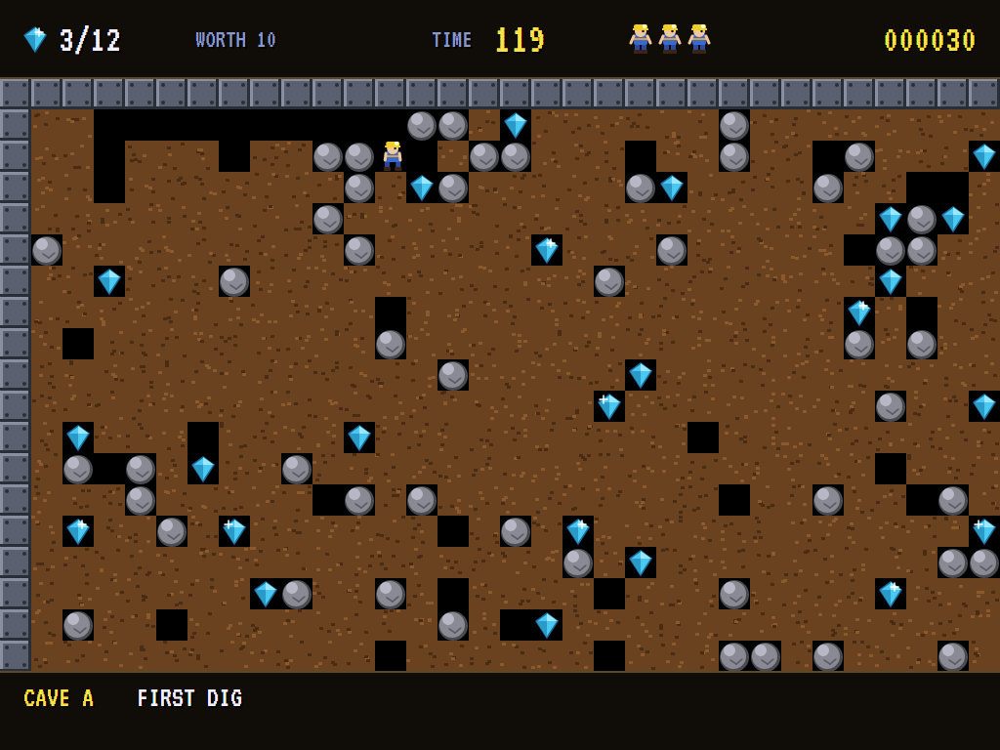 | 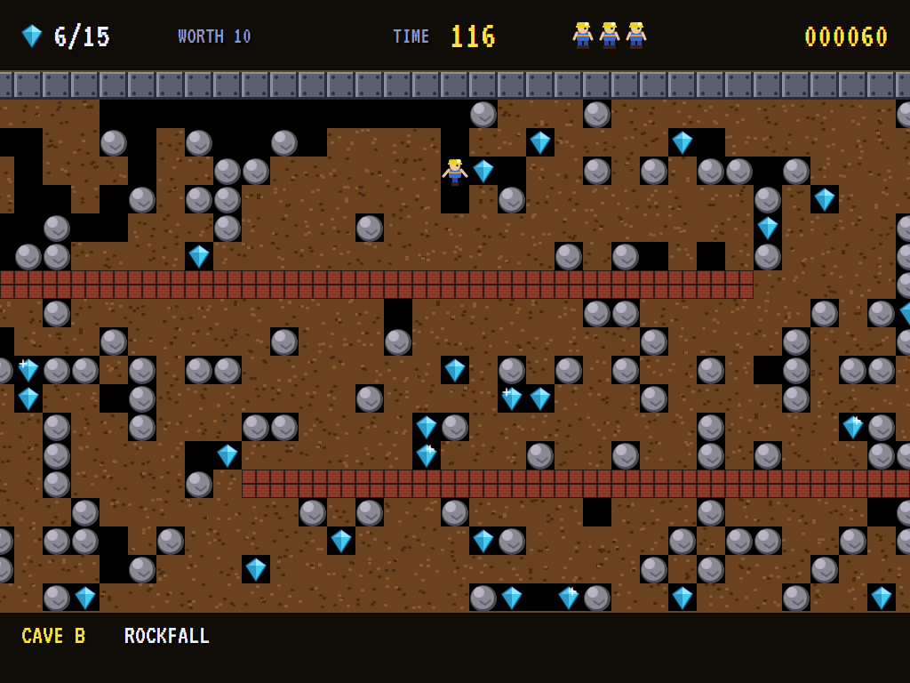 |
| Choose where to start. | Into the dirt. | Boulders piled on the walls. |

| Firefly Hollows | Butterfly Garden | The Slime |
|:---------------:|:----------------:|:---------:|
| 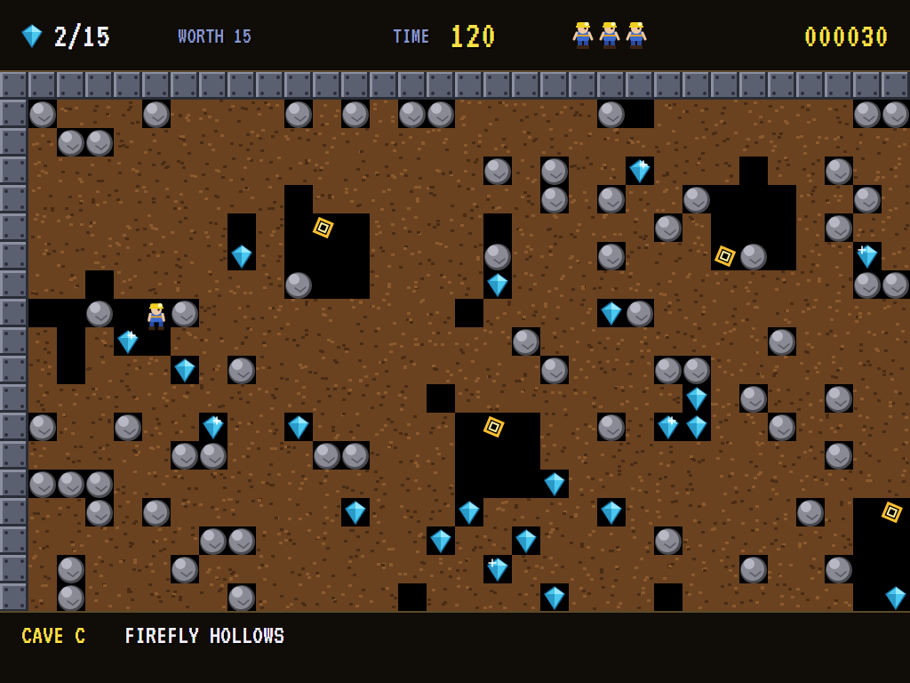 | 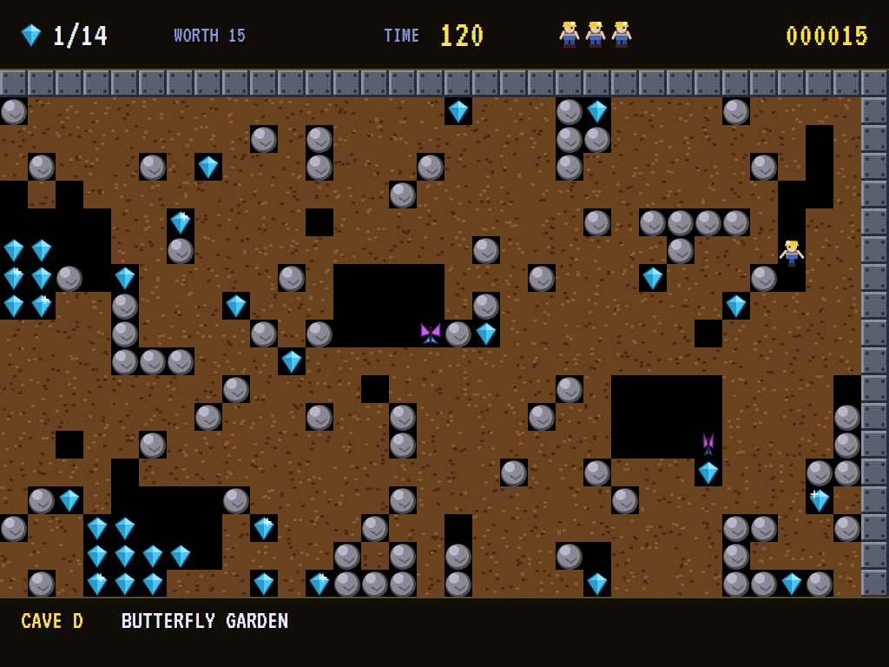 | 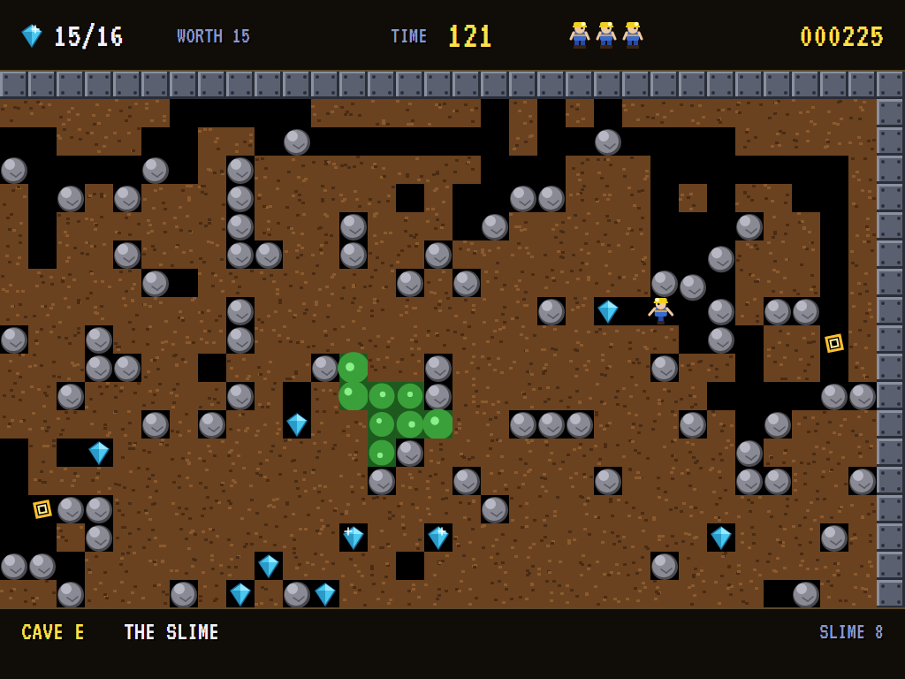 |
| Fireflies circling in their hollows. | Butterflies, waiting for a boulder. | Growing. |

| The Magic Wall | The way out | The Vault |
|:--------------:|:-----------:|:---------:|
| 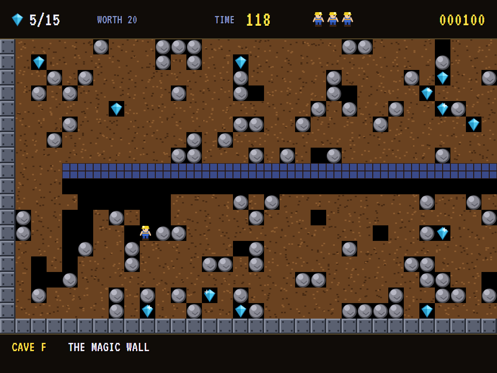 | 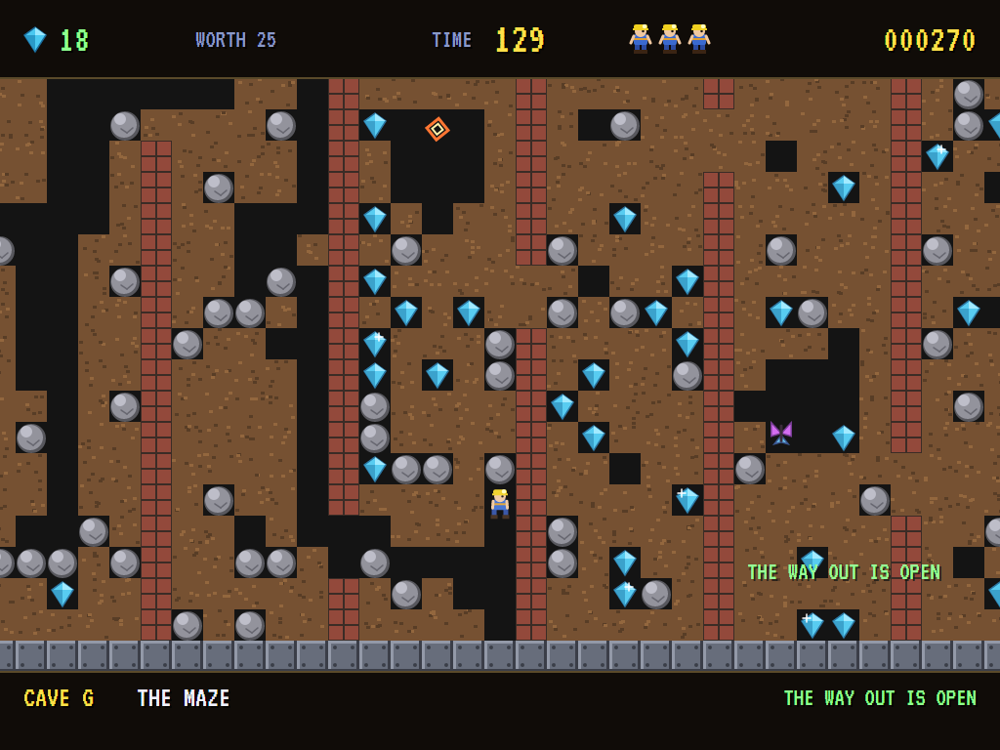 | 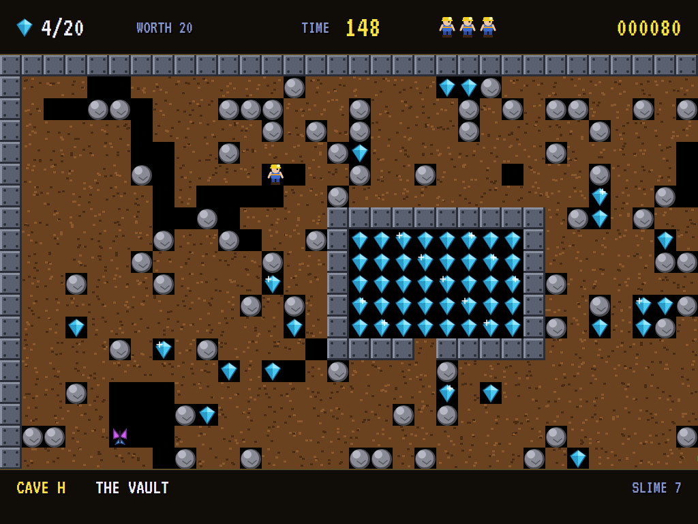 |
| Under the magic wall. | Enough diamonds: it opens. | A vault of diamonds, in steel. |

| A blast | The great diggers |
|:-------:|:-----------------:|
| 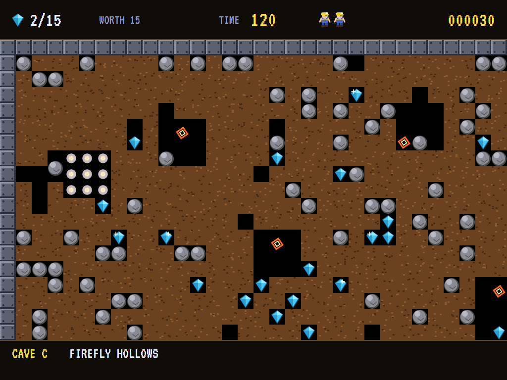 | 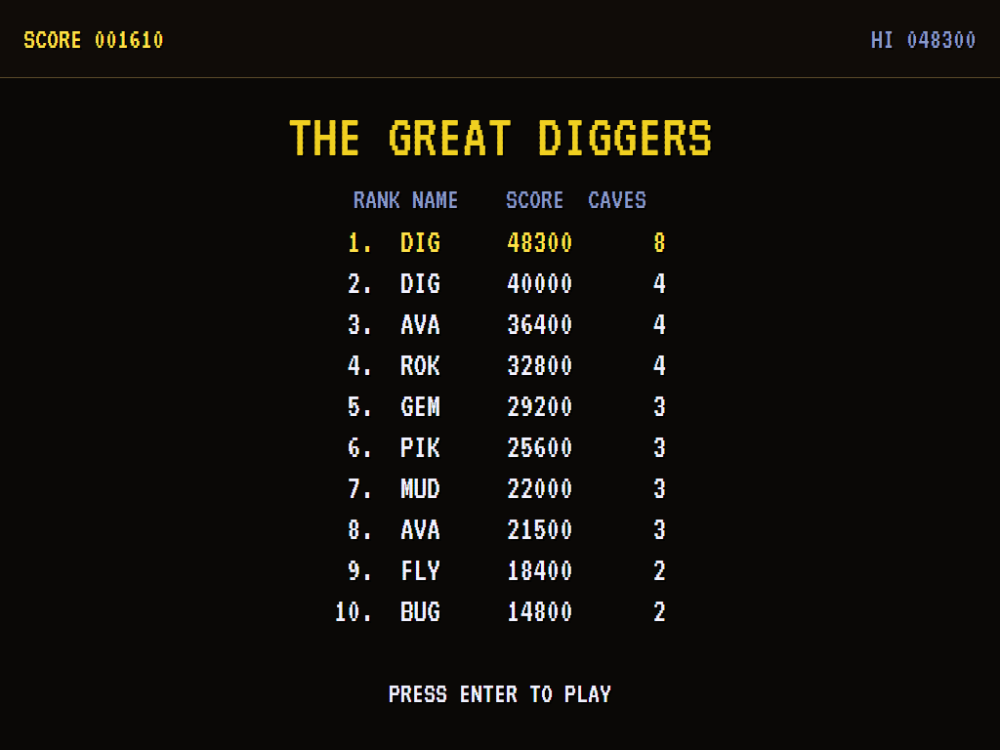 |
| Up it goes. | The high-score table. |

The screenshots are made by the tests, which play the game in a real (headless) window; see
[Tests](#tests).

## Download and run

Ready-to-run builds for Windows, macOS and Linux, on both Intel/AMD and ARM, are on the
[Releases page](https://github.com/Harlock123/AVABoulderDash/releases/tag/latest). **Latest build** is
rebuilt on every push to `main`. Each download is one self-contained executable: no .NET install is
needed.

| Platform | Archive |
|---|---|
| Windows | `AVABoulderDash-win-x64.zip`, `AVABoulderDash-win-x86.zip`, `AVABoulderDash-win-arm64.zip` |
| macOS | `AVABoulderDash-osx-arm64.tar.gz` (Apple silicon), `AVABoulderDash-osx-x64.tar.gz` (Intel) |
| Linux | `AVABoulderDash-linux-x64.tar.gz`, `AVABoulderDash-linux-arm64.tar.gz`, `AVABoulderDash-linux-arm.tar.gz` |

```bash
tar -xzf AVABoulderDash-linux-x64.tar.gz     # or linux-arm64, linux-arm, osx-arm64, osx-x64
./AVABoulderDash
```

On Windows, unzip and run `AVABoulderDash.exe`. On macOS, if Gatekeeper refuses to open it, run
`xattr -d com.apple.quarantine AVABoulderDash` once. Run with `--no-audio` for silence.

**Sound** comes through OpenAL Soft, built in for every platform. In a virtual machine the game
detects it and uses a larger audio buffer, so the sound doesn't break up.

**Gamepads** use SDL2, which is bundled for Windows, macOS and Intel/AMD Linux. ARM Linux builds need it
installed; without it the keyboard still works:

```bash
sudo apt install libsdl2-dev            # Debian / Ubuntu / Raspberry Pi OS
sudo pacman -S --needed sdl2-compat     # Arch / Omarchy
```

## Controls

| Action | Keyboard | Gamepad |
|---|---|---|
| Choose the cave to start from | Up and down on the title | D-pad |
| Start | Enter or 1 | Start |
| Move and dig | Arrows or W A S D | Left stick / D-pad |
| Grab without moving | Hold Space, Ctrl, Shift, Z or X with a direction | Hold A or B |
| Push a boulder | Keep moving against it | |
| Give up a try when shut in (a life) | R | Back |
| Pause | P or Esc | Start |
| Sound on/off | M | |
| Screenshot | Ctrl+S (to your Pictures folder) | |

On the high-score table, type your initials, or use up/down and Space, then Enter.

## Tests

```bash
dotnet test AVABoulderDash.slnx
```

The engine has no UI and runs in fixed 60 Hz steps, so it plays the same at any frame rate. The tests check:

- **The caves:** each comes out the same every time, walled in steel, with one way in, one way out, and
  diamonds to spare. The computer player clears every one without losing a life. A player who never touches
  the controls is safe at the way in until the time runs out.
- **Digging:** coming in at the way in; dirt, steel and walls; grabbing without moving; pushing a boulder
  (after a moment, and only into space).
- **Falling:** boulders fall through space, land, and roll off one another; a boulder resting overhead is
  safe, but a falling one crushes.
- **Diamonds and the way out:** enough diamonds open it and raise their worth. Through it, the time left
  counts into the score and the next cave begins. A shut way out is just wall.
- **Creatures:** a firefly circling its hollow, and blowing up when it meets Digby; a boulder on a butterfly
  leaving diamonds; steel surviving a blast.
- **The slime and the magic wall:** slime shut in turns to diamonds, and grown too big turns to boulders.
  The magic wall turns falling boulders into diamonds while it hums, then goes still for good.
- **The game:** running out of time, giving up, the last life and the high-score table, an extra life every
  500 points, the look-ahead leaving the cave as it was, the title's choice of cave, the demonstration, and
  the keys.

`tests/AVABoulderDash.Tests/PilotProbe.cs` reports how the computer player gets on in every cave, for tuning
(`BOULDER_PROBE=1`; `BOULDER_PROBE=lazy` for a player who never touches the controls).

The screenshot tests draw the real screen in a headless window. To refresh the README's pictures:

```bash
BOULDER_SHOTS=$PWD/Images dotnet test tests/AVABoulderDash.Tests --filter ScreenshotTests
```

## Building

```bash
dotnet build AVABoulderDash.slnx
dotnet run --project src/AVABoulderDash
```

Needs the .NET 10 SDK. The sounds and tunes are made by `tools/make_sounds.py` (standard-library Python):
`python3 tools/make_sounds.py` rewrites `src/AVABoulderDash/Sounds`.

## Project structure

```
AVABoulderDash/
├── AVABoulderDash.slnx
├── src/AVABoulderDash/
│   ├── Engine/
│   │   ├── GameEngine.cs        # States, the title and its choice of cave, the demonstration, the high scores
│   │   ├── GameEngine.Play.cs   # The turn: falling and rolling, Digby, fireflies and butterflies, the slime,
│   │   │                        # the magic wall, blasts, the clock, lives; looking ahead for the computer player
│   │   ├── Cave.cs              # Squares, the grid, and how a cave is described and laid out
│   │   ├── CaveBook.cs          # The eight caves
│   │   ├── Pilot.cs             # The computer player (the demonstration, and the tests)
│   │   ├── HighScoreTable.cs, InitialsEntry.cs
│   │   ├── InputHandler.cs, ControllerManager.cs  # Keys and an SDL2 gamepad
│   │   └── SoundManager.cs      # Effects and tunes through OpenAL
│   ├── Audio/                   # The OpenAL engine (from the author's AVABand)
│   ├── Views/                   # The drawing: every kind of square, Digby, the window onto the cave
│   └── Sounds/                  # The synthesised effects and tunes
├── tests/AVABoulderDash.Tests/  # Cave, gameplay and screenshot tests
├── tools/make_sounds.py
└── Images/                      # Screenshots
```

## About and licence

AVA Boulder Dash © 2026 Lonnie Watson, under the [MIT License](LICENSE).

*Boulder Dash* © 1984 First Star Software, created by Peter Liepa and Chris Gray; the name belongs to its
current owner. AVA Boulder Dash is an independent, unofficial game in its style. Its caves, its hero Digby,
its graphics, sounds, tunes and code are its own; nothing is taken from the original game's program, caves,
graphics or sound. It is not affiliated with or endorsed by any rights holder.
